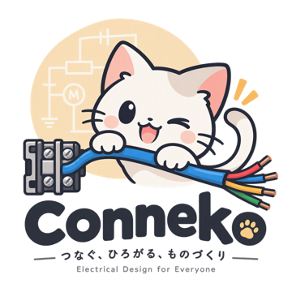
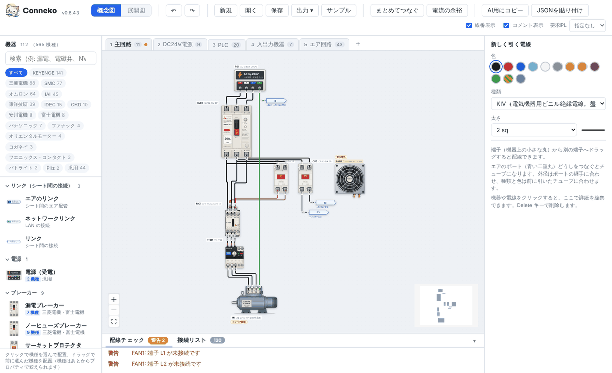
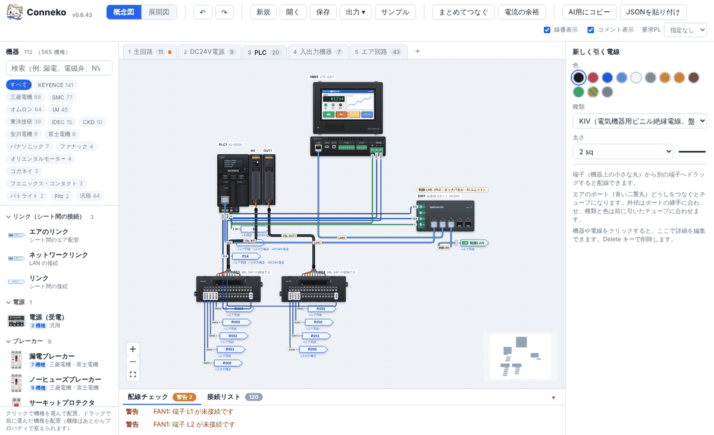
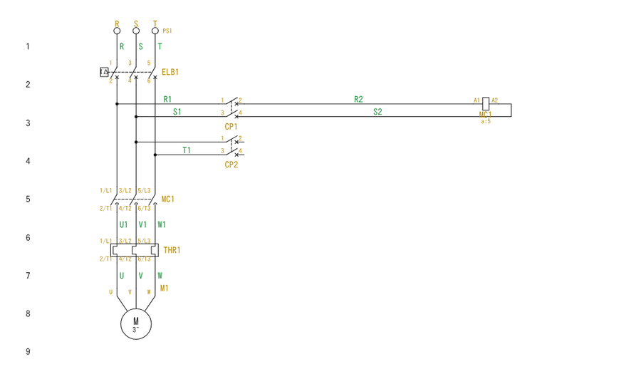
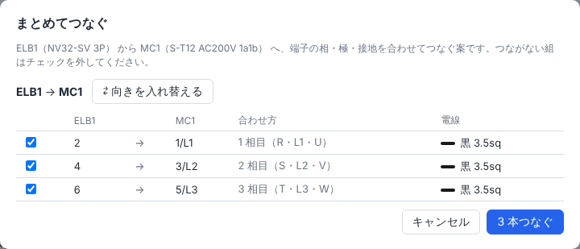
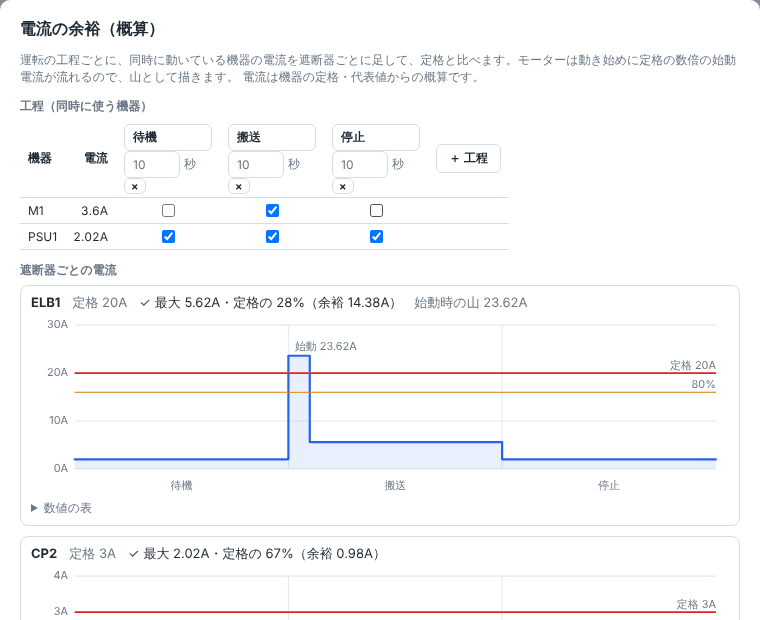

<p align="center">
  
</p>

<h1 align="center">Conneko</h1>

<p align="center">
  <b>つなぐ、ひろがる、ものづくり</b><br>
  生産設備の電気配線とエア回路を、専門知識や専用 CAD なしで手軽に描ける作図ツール
</p>

<p align="center">
  <a href="https://github.com/yukimasui/conneko/releases/latest"><b>ダウンロード</b></a> ·
  <a href="docs/features.md">機能の詳しい説明</a> ·
  <a href="docs/data-format.md">データ形式</a> ·
  <a href="#ライセンス">ライセンス</a>
</p>



実物に近い見た目の機器をキャンバスに置き、端子どうしをつなぐだけ。配線の誤りはその場でチェックされます。

## 使い方

1. [Releases](https://github.com/yukimasui/conneko/releases/latest) から `conneko-v*.html` をダウンロードします。
2. ブラウザで開きます（インストール・サーバー・インターネット接続は不要）。
3. 左の一覧から機器を置き、端子どうしをドラッグしてつなぎます。上のバーの「サンプル」で例の図面を開けます。

## できること

- **実物そっくりの機器 600 種以上** — 三菱電機・KEYENCE・オムロン・SMC・IAI・ファナック・安川電機ほか（[下の表](#収録している機器)）
- **配線をその場でチェック** — 短絡・地絡、電圧・極性、電線の太さ、NPN/PNP、安全回路（2 チャンネル・PL）など
- **まとめてつなぐ** — 2 台の機器をクリックすると、相・極・電圧を合わせて一気に配線
- **電流の余裕** — 同時に動く機器を工程で選び、遮断器の余裕をグラフで確認
- **展開図と DXF** — 概念図から JIS 記号の展開接続図を起こし、DXF に書き出し
- **PLC の I/O** — ユニット構成・I/O 割付・I/O 表をまとめて管理
- **出力** — 印刷・PDF（図面枠付き）、部品表・線番表・I/O 表の CSV
- **生成 AI と連携** — 図面の JSON を AI に渡して配線させ、返ってきた JSON を読み込む

| 概念図（PLC のシート） | 展開図（主回路） |
|---|---|
|  |  |
| **まとめてつなぐ** | **電流の余裕** |
|  |  |

操作の詳しい説明は [docs/features.md](docs/features.md) にあります。

## 収録している機器

| 分野 | 主なメーカー・機種 | 一覧 |
|---|---|---|
| ブレーカー・開閉器・計器 | 三菱電機（WS-V・FA・CP30-BA・S-T・MSO-T・TH-T・NV-ZBA・EMU4）、富士電機、パナソニック BBW・BJW | [三菱電機・富士電機](docs/mitsubishi-catalog.md) |
| 盤の電源・保護・つなぎ部品 | オムロン S8VK-G・G7TC・G3PE・XW2R、IDEC PS5R、フエニックス・コンタクト CBMC、エム・システム技研 W2VS、トランス・ヒューズ・計器 | [電源・保護](docs/power-catalog.md) |
| PLC・タッチパネル | KEYENCE KV-8000 / KV-X・VT5、三菱電機 iQ-R / iQ-F・GOT、オムロン NX1P2・NX102・CP2E・NB、シーメンス S7-1200 | [KEYENCE](docs/keyence-catalog.md)・[三菱電機](docs/mitsubishi-plc-catalog.md)・[オムロン](docs/omron-plc-catalog.md)・[通信](docs/network-catalog.md) |
| センサー・計測 | KEYENCE、オムロン、パナソニック、SICK、SMC、エー・アンド・デイ（ロードセルと指示計） | [KEYENCE](docs/keyence-catalog.md)・[センサー](docs/sensor-catalog.md) |
| 操作・表示・制御機器 | オムロン A22N・MY・H3CR・E5CC、IDEC、富士電機 AR22、パトライト | [汎用・制御](docs/generic-catalog.md)・[表示・操作](docs/control-catalog.md) |
| 安全機器 | KEYENCE、オムロン（NX-SL ほか）、IDEC、Pilz、三菱電機 | [安全機器](docs/safety-catalog.md) |
| モーター・駆動 | 三菱電機 FR-E820・FR-A820・FR-F820・MR-J5、安川電機 GA500・Σ-7、パナソニック MINAS A6、オリエンタルモーター | [駆動機器](docs/drive-catalog.md) |
| ロボット | ファナック LR Mate 200iD・SR-3iA（スカラ）・M-1iA（パラレルリンク）、安川電機 GP7、デンソー VS-060、川崎重工 RS007N、IAI ロボシリンダ | [ロボット](docs/robot-catalog.md)・[IAI](docs/iai-catalog.md) |
| 空圧 | SMC、CKD、コガネイ | [SMC](docs/generic-catalog.md)・[CKD・コガネイほか](docs/air-catalog.md) |
| 端子台 | 東洋技研、フエニックス・コンタクト、MIL 変換端子台 | [東洋技研](docs/toyogiken-catalog.md)・[オムロン PLC と端子台](docs/omron-plc-catalog.md) |

メーカーの資料で確かめられなかった値は「推定」と表示します。実際の設計に使う前に、カタログ・実機で確かめてください。

## ライセンス

[Conneko License 1.1](LICENSE)（ソースコード公開。OSI の定義するオープンソースではありません）

- 個人・教育機関・研究機関・非営利団体は、無償で使用・改変・再配布できます。
- **企業での利用は、試用・評価・社内での紹介を含めて、使う前に作成者（[@yukimasui](https://github.com/yukimasui)）に連絡し、許諾を得てください。**
  従業員が個人の端末で業務のために使う場合も同じです。許諾を得た企業も、取引先・グループ会社などへ渡すには作成者の同意が必要です。
- 許諾は、作成者がサポートや結果への責任を引き受けることを意味しません。
- 無保証です。配線チェックの結果や機器のデータは参考であり、法令・規格への適合や安全を保証するものではありません。
- 同梱している外部ライブラリ（React、React Flow など）のライセンスは、アプリ左上のバージョンを押すと表示される「Conneko について」で確認できます。

## 開発

Node.js 24 以降が必要。

```sh
npm install
npm run dev        # 開発サーバー
npm test           # ユニットテスト（配線チェック）
npm run typecheck  # 型チェック
npm run build      # dist/index.html を生成
```

機器の追加方法は [docs/device-authoring.md](docs/device-authoring.md) を参照。

## 構成

```
src/
  devices/        機器定義（catalog/ に1機器1ファイル）と型・レジストリ・パラメータの解決（resolve）
  data/wires.ts   電線の種類・許容電流・色の基礎データ
  check/          配線の電気的チェック（model: 同電位グループ、states: 接点の開閉、signals: 信号、safety: 安全回路）
  model/          図面データ（JSON）の型と読み書き、装着（bus）、サンプル図面
  editor/         キャンバス、機器ノード、電線の描画と経路計算、各パネル
  io/aiPrompt.ts  生成AI用プロンプトの組み立て
scripts/
  render-device.ts  機器定義のプレビュー画像出力・整合性検査
```
